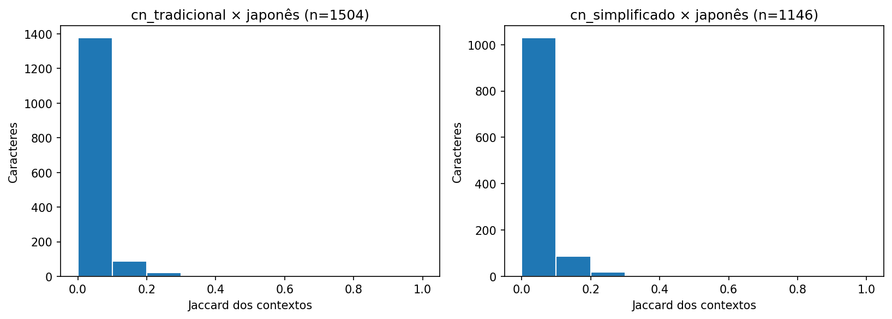
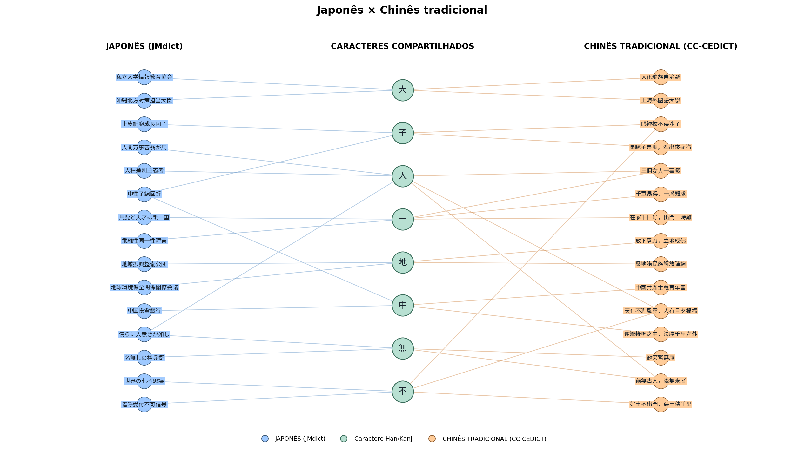

# L.O.T.U.S. (Linguística Oriental: Topologia de Usos Semânticos): contextos lexicais em chinês e japonês

Projeto da Unidade 1 de Algoritmos e Estruturas de Dados II. Redes de palavras e
caracteres construídas a partir de dois dicionários reais, com análise em um único
notebook: [LOTUS.ipynb](LOTUS.ipynb).

[](https://colab.research.google.com/github/39Matheus/AED2/blob/Work_Branch/LOTUS.ipynb)

## Integrantes

- Bárbara Lima Cordeiro da Silva ; 20220013738
- Mateus Vinicius Figueredo de Araújo; 20260000707
- Matheus Bezeril Pinto ; 20260000716

## Vídeo

[LINK DO VÍDEO NO YOUTUBE]

## Problema e pergunta

Estudantes de japonês e chinês encontram caracteres iguais em palavras de línguas
diferentes. Quais caracteres compartilhados apresentam contextos de coocorrência
mais semelhantes ou diferentes nos dicionários CC-CEDICT e JMdict? O resultado
muda ao comparar o japonês com o chinês tradicional ou simplificado?

A estrutura da rede importa porque o contexto de um caractere é definido pelos
outros caracteres ligados a ele por palavras. O projeto permite explorar esses
contextos e inspecionar palavras/definições, sem exigir um sistema de tradução.

O código analisa como os caracteres se combinam nas palavras. As definições dos 
dicionários estão disponíveis para consulta, mas não entram no cálculo do Jaccard.

Por exemplo, 手紙 costuma significar “carta” em japonês e “papel higiênico” em chinês. 
As formas têm os mesmos caracteres: a rede que registra apenas palavra → caracteres não 
consegue reconhecer essa diferença de significado.

## Dados: fonte, obtenção e limpeza

- **CC-CEDICT:** dicionário chinês–inglês distribuído pelo
  [MDBG](https://www.mdbg.net/chinese/dictionary?page=cedict), com grafias
  tradicional/simplificada, pinyin e definições. O download vem do
  [arquivo oficial compactado](https://www.mdbg.net/chinese/export/cedict/cedict_1_0_ts_utf-8_mdbg.txt.gz).
- **JMdict:** dicionário japonês do
  [EDRDG](https://www.edrdg.org/jmdict/j_jmdict.html); usamos o
  [JMdict_e.gz](https://ftp.edrdg.org/pub/Nihongo/JMdict_e.gz), com definições inglesas.

As seções 3–4 do notebook baixam e processam os arquivos. As requisições têm
timeout e validação TLS/HTTP; o gzip é validado antes de ser salvo. O cache fica
em `data/raw/`, fora do Git. Para atualizar, remova os dois arquivos `.gz`.

O manifesto registra URL, tamanho, SHA-256 e primeira leitura de cada cópia.
Os arquivos oficiais mudam com o tempo: resultados idênticos exigem os mesmos
arquivos e parâmetros, não apenas a mesma semente. O registro desta execução está
em [resultados/execucao.json](resultados/execucao.json), e as unidades amostradas
foram preservadas nos CSVs.

Limpeza:

1. Normaliza grafias com Unicode NFC; preserva diferenças entre variantes.
2. Ignora comentários do CC-CEDICT e reporta linhas não reconhecidas.
3. Preserva todas as grafias `keb` do JMdict e respeita restrições de grafia/leitura
   ao reunir definições. Formas sem Han ficam fora.
4. Agrupa sentidos repetidos por par de grafias chinesas e por grafia japonesa.
5. Seleciona, sem reposição e com semente 42, 5.000 pares chineses e 5.000 grafias
   japonesas. A amostra é extraída depois da limpeza, em vez das primeiras linhas.
6. Ao construir cada rede, reúne novamente as palavras por grafia da variante;
   cada caractere aparece uma vez por palavra, mesmo se repetido na escrita.

Definições agrupadas não alinham sentidos entre línguas. Os dicionários não são bases de dados de frequência e incluem nomes próprios, termos especializados e variantes.

## Modelagem

| Elemento | Definição e justificativa |
| --- | --- |
| Nós de palavra | Uma forma escrita por idioma/variante; prefixos diferentes evitam fundir palavras chinesas e japonesas. |
| Nós de caractere | Um caractere Han; coincidência do código Unicode permite conectar as redes. |
| Aresta bipartida | A palavra contém o caractere; presença binária, sem direção e sem peso. |
| Grau do caractere | Número de formas escritas distintas que o contêm na amostra. |
| Grau relativo | Grau dividido pelo número de palavras da rede; ajuda a comparar tamanhos diferentes. |
| Projeção | Caracteres ligados por ocorrência numa mesma palavra; peso = quantidade de palavras distintas em comum. |
| Jaccard | Interseção/união dos vizinhos das projeções, no universo de caracteres compartilhados daquela comparação; ignora pesos. |
| Contextos vazios | Se a união é vazia, Jaccard fica indefinido (`NaN`). |

As métricas usam três grafos bipartidos puros: japonês, chinês tradicional e
simplificado. As duas variantes chinesas vêm dos mesmos pares amostrados.
Na visualização interativa simplificado × tradicional, um grafo separado recebe
arestas entre formas da mesma entrada do CC-CEDICT. Essas relações não entram na
densidade bipartida, nas componentes ou nas projeções analisadas.

Ficam de fora frequência de uso, ordem/repetição dos caracteres, conversão
automática entre variantes, alinhamento de sentidos e relações de tradução.

## Conteúdo do curso utilizado

As referências abaixo usam os títulos das seções, estáveis mesmo após inserir células.

| Conceito | Semana | Onde aparece em `LOTUS.ipynb` | Para que serviu |
| --- | --- | --- | --- |
| Grafo simples, atributos e subgrafos | 2 | §§1, 6 e 11–12; `build_word_character_graph` | Tornar explícitas as relações e separar a amostra visual da rede analisada. |
| Grau e densidade | 2 | §§7 e 9; `df_summary`, `compare_contexts` | Medir participação dos caracteres e densidade entre partições. |
| Componentes conexas | 4 | §7; `nx.connected_components` | Mostrar fragmentação e tamanho da maior componente. |
| Redes bipartidas | 6 | §6; `build_word_character_graph`, verificações de partições | Representar palavras e caracteres sem misturar tipos de relação. |
| Matriz de incidência | 6 | §8; `incidence_example` | Inspecionar presença de caracteres por palavra. |
| Projeção e coocorrência | 6 | §9; `weighted_projected_graph` | Construir contextos de caracteres ligados por palavras. |
| Jaccard | 6 | §9; `compare_contexts` | Comparar conjuntos de contextos e explicitar suporte e casos indefinidos. |

## Como executar

**Colab:** abra o link acima e execute todas as células na ordem. A seção 2 instala
as bibliotecas com versões fixadas. Para rótulos CJK, instale `fonts-noto-cjk`
se a fonte estiver ausente e reinicie o kernel. A análise funciona sem essa fonte.

**Localmente:** Python 3.11 recomendado. A partir da raiz do repositório:

```bash
python -m venv .venv
source .venv/bin/activate
python -m pip install -r requirements.txt
jupyter execute LOTUS.ipynb --inplace --timeout=600
```

No Windows, ative com `.venv\Scripts\activate`. Alternativamente, abra o notebook
em seu ambiente Jupyter e execute todas as células. A primeira execução requer
internet; as demais reaproveitam o cache. Em Linux, a fonte pode ser instalada com
`sudo apt-get install fonts-noto-cjk` antes de iniciar o kernel.

Parâmetros da seção 2: `N_CN`, `N_JP`, `SEED` e `INTERACTIVE_INLINE`. O valor `-1`
usa uma fonte inteira, com maior custo de memória e projeção. `MIN_SUPPORT = 3`
na seção 9 filtra apenas o ranking; os CSVs preservam todos os resultados.

Saídas:

- `resultados/limpeza.csv` e `resumo_redes.csv`: cobertura e estrutura.
- `resultados/amostra_cn.csv` e `amostra_jp.csv`: dados efetivamente analisados.
- `resultados/contextos_*.csv` e `conclusoes.csv`: graus, contextos e Jaccard.
- `resultados/figuras/`: quatro PNGs gerados pelo código.
- [resultados/grafos/](resultados/grafos/): três HTMLs interativos incluídos no Git.
  As redes são embutidas no notebook por padrão (`INTERACTIVE_INLINE = True`).
  Execute no Colab/Jupyter para interagir ou baixe os HTMLs e abra no navegador.
  O visualizador de notebooks do GitHub não executa JavaScript.

## Resultados

Execução com `N_CN = N_JP = 5000` e `SEED = 42`:

| Rede | Palavras | Caracteres | Arestas | Componentes | Nós na maior componente |
| --- | ---: | ---: | ---: | ---: | ---: |
| Chinês tradicional | 5.000 | 3.229 | 12.920 | 433 | 88,52% |
| Chinês simplificado | 4.998 | 3.155 | 12.918 | 410 | 88,97% |
| Japonês | 5.000 | 2.325 | 12.572 | 156 | 95,15% |

Os 5.000 pares chineses selecionados resultam em 4.998 grafias simplificadas
distintas, pois alguns pares compartilham a mesma forma simplificada.

Há **1.517 caracteres compartilhados** entre japonês/tradicional e **1.162** entre
japonês/simplificado. O Jaccard é definido para 1.504 e 1.146 caracteres, respectivamente;
1.052 e 803 desses valores são zero. As medianas são zero e as médias são cerca de
0,0273 e 0,0278. Com suporte de pelo menos três palavras em cada idioma, restam
681 e 547 caracteres para os rankings exploratórios.

Nesta amostra, a sobreposição dos contextos observados é pequena. Isso responde à
pergunta sobre a estrutura observada, mas a baixa cobertura de palavras por
caractere impede concluir que seus significados divergem. O maior compartilhamento
gráfico com o tradicional também não demonstra maior equivalência semântica.
As médias usam universos diferentes; não isolam um efeito da variante escrita.





## Limitações e próximos passos

- A amostra pequena perde vizinhos; zeros de Jaccard podem decorrer da amostragem.
  Aumentar `N_CN`/`N_JP` e repetir com outras sementes ajuda a avaliar estabilidade.
- Os dicionários têm políticas editoriais e coberturas distintas. Igualar o número
  de unidades amostradas não iguala frequência ou familiaridade.
- As variantes japonesas entram como grafias distintas e os homógrafos se unem
  por escrita. Agrupar definições não resolve completamente polissemia e leituras.
- Compartilhar um código Unicode não significa compartilhar um significado;
  caracteres variantes não são convertidos automaticamente.
- A projeção perde a identidade das palavras e cria cliques para palavras longas.
  Por isso não inferimos comunidades semânticas a partir de triângulos.
- Os desenhos priorizam hubs e limitam palavras por caractere, para legibilidade;
  as estatísticas usam toda a amostra, e o layout não é medida de similaridade.

Próximo passo suficiente para este escopo: selecionar alguns caracteres com mais
suporte, examinar suas palavras/definições e escrever uma interpretação qualitativa.
Uma afirmação sobre divergência semântica precisaria dessa validação adicional.

Antes da entrega, preencher o link do vídeo.

## Referências e créditos

- CC-CEDICT e seus colaboradores, distribuído pelo [MDBG](https://www.mdbg.net/chinese/dictionary?page=cedict).
- JMdict, Electronic Dictionary Research and Development Group:
  [documentação](https://www.edrdg.org/jmdict/j_jmdict.html) e
  [licença](https://www.edrdg.org/edrdg/licence.html).
- Ambos os dicionários são distribuídos sob
  [Creative Commons Attribution-ShareAlike 4.0](https://creativecommons.org/licenses/by-sa/4.0/).
  Os CSVs de amostras contêm dados derivados dessas fontes e mantêm esses créditos e licença.
- [NetworkX: redes bipartidas e projeções](https://networkx.org/documentation/stable/reference/algorithms/bipartite.html).
- Material da disciplina, semanas 2, 4 e 6. Disponível no [Github do Professor](https://github.com/ivanovitchm/datastructure)
